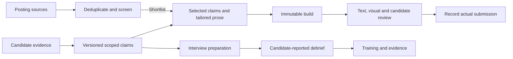

# Design and scope

Careerflow pairs an Agent Skills instruction package with a deterministic local Python engine. It is intended for one candidate per private workspace, across professions and stages of a career. The agent supplies interpretation, research, writing and review; the engine supplies reliable records. No model API, provider lock-in, paid service, background worker or submission bot is required.

## Ownership

- `careerflow/`: sole runtime implementation. SQLite owns job/source state; versioned JSON owns profile claims. CLI mutations serialize with a POSIX advisory lock, batches use SQLite transactions and file replacements are atomic.
- `skills/job-application-workflow/`: portable instructions, progressively loaded references and a wrapper. No provider-specific tool calls or shell substitutions inside the skill body. Optional Codex UI metadata does not affect the core workflow.
- `scripts/package_skill.py`: explicit allowlist builds a standalone ZIP containing a snapshot of this same runtime. Generated runtime copies are not maintained source.
- `scripts/install_skill.py`: verifies bundle inventory and hashes, rejects path escapes/symlinks and refuses existing installations. Hashes prove internal consistency, not publisher authenticity; install only trusted releases.
- Private workspace: `data/`, evidence, drafts, submissions, interviews/training and generated navigation. Installed code is not the workspace. `--root` is explicit; without it, the current directory is used.

The source repository includes only fictional demonstrations and synthetic tests. It was extracted from a personal workflow using a reviewed file allowlist and a fresh Git history. Original candidate records, scripts tied to specific requisitions, browser state and employer documents are excluded. Public upstream development does not automatically migrate any existing private workspace.

## Invariants

1. Facts need provenance and correct employer/project scope. Unknown differs from explicit no experience. Study is not professional experience.
2. Pursuit, priority, stage, outcome, build freshness and review status remain separate. Screening and claim retrieval do not estimate interview probability.
3. Selected dependencies determine build freshness. Unrelated facts do not invalidate all drafts. Submitted versions are immutable and hash checked.
4. Text checks, visual inspection and candidate review are distinct. Neither a successful test nor an older approval approves a new PDF.
5. Preparation is not submission. Interview records need not invent a prior application. Training completion requires an artifact and result note but does not certify competence.
6. Paths stay within the private root. External content is data, never executable instructions. Software installation does not authorize external applications, messages, paid services or publishing.

## Storage and recovery

Retain the existing SQLite/JSON/Markdown architecture rather than introduce a hosted service. Job source text is content-addressed in SQLite; job/source checkpoints permit reconstruction in an empty database. They are not a backup of profiles, learning notes or PDFs. Back up the entire workspace. No live database must be deleted to test restore.

Interview and training JSON files are appropriate for the much smaller learning workload. Detailed preparation, lab instructions and debriefs remain Markdown referenced by those records. Changes preserve history and do not mutate career claims or application stage.

## Compatibility and limits

Python 3.10+, Linux/macOS/WSL. Native Windows is not supported because the engine uses POSIX locks. PDF generation uses ReportLab and Poppler; metadata commands use the standard library. The renderer currently targets US Letter and built-in Latin fonts. Non-Latin typography, arbitrary page formats, historical submission import without artifacts, automatic source retrieval, encrypted storage, multi-user hosting and automated submission are not implemented.

The same bundled script is tested outside this checkout and in host-like skill directories. Native Codex and Claude Code end-to-end invocation is not yet tested; their discovery behavior depends on client version/configuration. Installation paths are documented from official sources. Other agents can read SKILL.md explicitly when they lack native discovery.

## Release decisions

MIT supports broad personal and commercial reuse with notice preservation. It applies to this project's code, instructions and fictional examples, not users' private records or third-party job text. Python dependencies retain their own licenses. Apache-2.0 would add an explicit patent grant and more license machinery; it is not needed for the initial lightweight release.

Version 0.2.0 is an alpha. Retain a single skill until actual usage demonstrates a need to split it. Prioritize onboarding and data fidelity before source adapters, elaborate dashboards or background automation. Improve from concrete user feedback and reproducible failures rather than speculative infrastructure.

## Guided training sessions (0.2.0)

`training.py` owns session transitions inside existing training records: requested → ready → practicing → submitted → reviewed → completed, with reviewed → practicing for retries. Existing legacy records need no migration. Each lesson has a goal, explanation, exercise, staged hints, rubric and optional verified resources. Drafts are shared workspace data; attempts are separate hash-checked artifacts. Every criterion must be reviewed, and a passing latest attempt is required for completion. Generic progress commands cannot bypass these gates or reopen completed sessions.

The agent generates a plan from bounded profile/job/interview context, or reviews a submitted attempt using the skill's documented JSON schemas. The local web app creates requests and shows copyable agent prompts. There is no automatic model invocation, API credential, paid service, or execution of candidate code. This explicit handoff works with whichever supported agent the candidate chooses.

`training_web.py` serves only its bundled UI and narrow session APIs, never the workspace filesystem. It binds to 127.0.0.1, validates Host, requires a per-process token for API access, checks Origin and JSON content type for writes, limits request size and disables caching. Displayed user/agent text uses textContent rather than HTML. This is a local personal service, not authenticated multi-user hosting. Do not expose or proxy it publicly. CLI and web mutations share the same POSIX workspace lock and atomic JSON writes.

The launcher initializes a private workspace when missing, starts a detached local server, checks readiness, reuses only a server for that same root and prints its URL. A different app/workspace on the port produces an actionable error. A foreground option supports Ctrl-C lifecycle management. The existing personal browser-local planner is not imported or rewritten; its progress remains separate.
